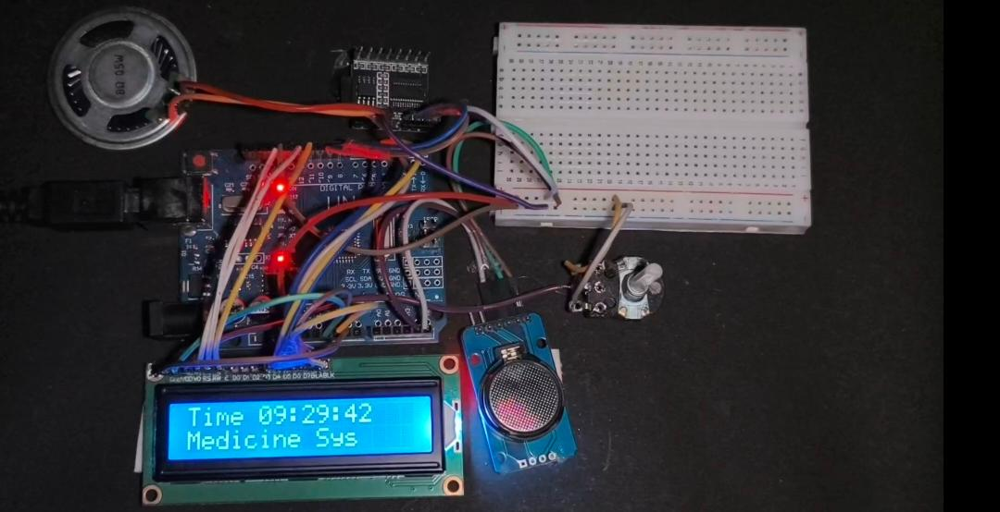
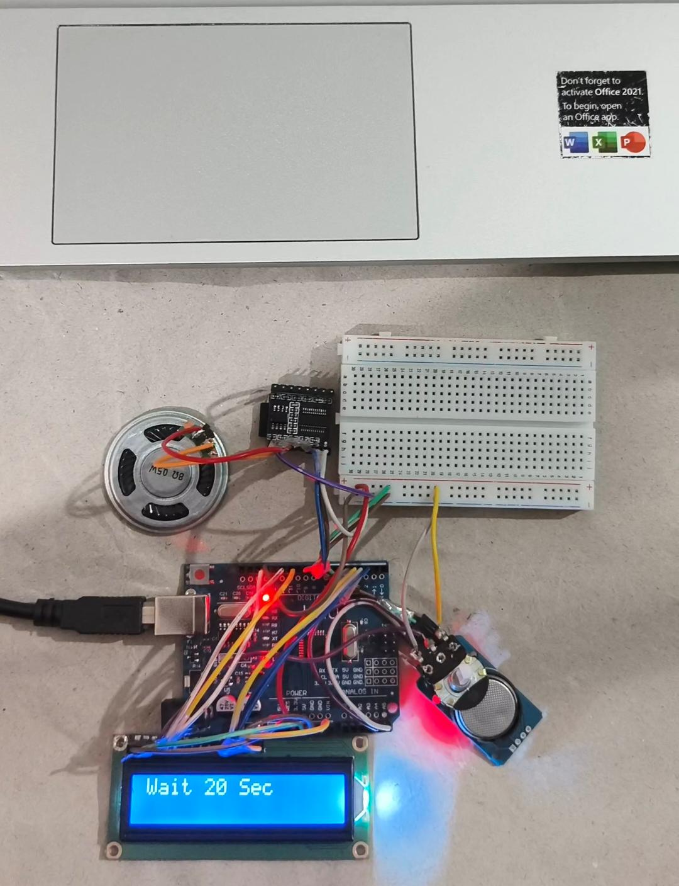

# Arduino-Based Medicine Reminder System 💊

## 📌 Overview

The Medicine Reminder System is an Arduino-based mini-project designed to help people remember their scheduled medication times through a visual message and an audio alert.

It combines a real-time clock, LCD display, and audio playback module to demonstrate a practical application of embedded systems.

## 🎯 Problem Statement

People may forget their scheduled medication times during busy daily routines. This project demonstrates a simple electronic system that provides a reminder at a preset time.

## ✨ Features

- Displays the current time on a 16×2 LCD.
- Uses a DS3231 Real-Time Clock (RTC).
- Displays a medicine reminder at a preset time.
- Plays an audio alert through the DFPlayer Mini.
- Uses Arduino to coordinate the connected modules.

## 🧰 Hardware Components

- Arduino-compatible development board
- DS3231 RTC module
- 16×2 LCD
- DFPlayer Mini audio module
- Speaker
- Jumper wires and suitable power supply

## 💻 Software and Libraries

- Arduino IDE
- RTClib
- LiquidCrystal
- SoftwareSerial
- DFRobotDFPlayerMini

## ⚙️ Working Principle

1. The DS3231 RTC provides the current time.
2. Arduino reads the time and displays it on the LCD.
3. The program compares the current time with the preset reminder time.
4. When the time matches, the LCD displays a medicine reminder.
5. The DFPlayer Mini plays the configured audio track.

## 🔌 Pin Connections

| Component | Arduino connection |
|---|---|
| LCD RS | Digital pin 12 |
| LCD Enable | Digital pin 11 |
| LCD D4 | Digital pin 5 |
| LCD D5 | Digital pin 4 |
| LCD D6 | Digital pin 3 |
| LCD D7 | Digital pin 2 |
| DS3231 SDA | A4 (Uno) |
| DS3231 SCL | A5 (Uno) |
| DFPlayer TX | Digital pin 8 |
| DFPlayer RX | Digital pin 9 |

Connect grounds appropriately and provide suitable power to each module. Use appropriate signal-level protection for the Arduino TX signal going to the DFPlayer RX pin.

## ⚠️ Limitations

- The reminder time is fixed in the source code.
- The current version supports one preset reminder time.
- The system does not verify whether medication was actually taken.
- This is an educational prototype, not a certified medical device.

## 🚀 Future Improvements

- Add support for multiple reminder times.
- Allow users to set reminders using buttons.
- Add an alert acknowledgement feature.
- Improve the display update to reduce flickering.
- Add improved power management.

## 🎥 Demonstration

## 📸 Project Gallery

### Complete Hardware Setup

### LCD Display

## 🎥 Working Demo

[View the working-demo.mp4 video](working-demo.mp4)

The demonstration shows the project hardware and its medicine reminder operation.

